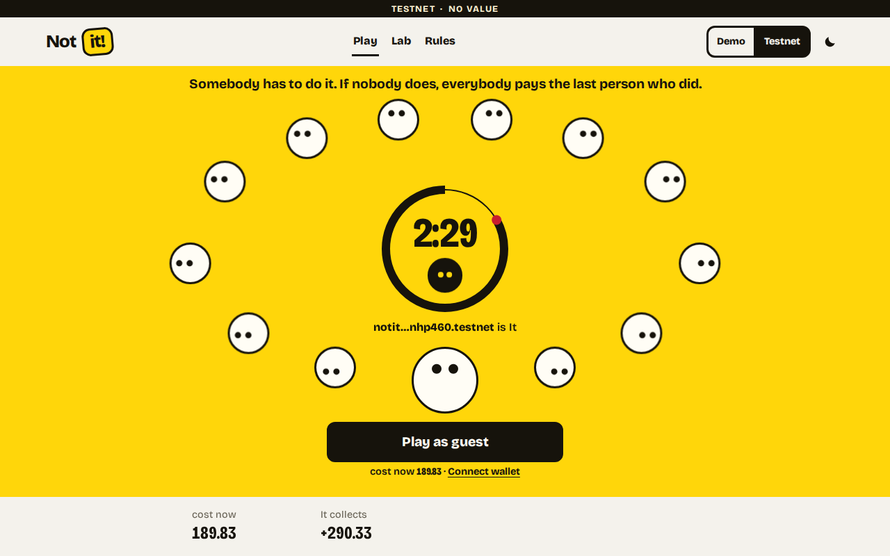

# Not It ($NOTIT)

[](https://github.com/arshiaxbt/notit/actions/workflows/ci.yml)

A memecoin whose only mechanic is a recurring auction for one seat, "It": a volunteer's dilemma for large holders, a last-mover contest for everyone else. On NEAR testnet.

**Somebody has to do it. If nobody does, everybody pays the last person who did.**

[](https://arshiaxbt.github.io/notit/)

A 70-second recording of one real session on testnet (claim, volunteer, a round nobody saves): [docs/media/demo.mp4](docs/media/demo.mp4).

| | |
|---|---|
| Hackathon | Built at NEAR HACKATHON (development phase 1–14 November 2026). Track: `memecoins` (Memecoins With Mechanics) |
| Live demo | https://arshiaxbt.github.io/notit/ |
| Contracts (NEAR testnet) | `notit-play.testnet` (3-minute rounds), `notit-live.testnet` (1-hour rounds). Both locked: no access keys |
| Status | Testnet only. Test tokens with no value. No human or professional audit (see "How correctness is checked") |

## What it is

Not It is an NEP-141 token with one game built into the contract:

1. Time is split into rounds.
2. In each round a **sacrifice cost** starts at 5 % of the supply and falls linearly to 0.2 % at the deadline.
3. The first holder to volunteer burns the current cost from their own balance. The round is saved and that holder becomes **It**.
4. If a round ends with no volunteer, every balance is cut 15 % and the whole cut is paid to It. At most 8 unsaved rounds in a row are charged; then the game sleeps until somebody volunteers. Before the first volunteer there is no It and nothing is charged.
5. Nothing can be changed after deployment: the contract stores no owner, has no setter, and the deployed accounts have no access keys.

## The problem it addresses

The track asks for memecoins "where the meme does something" and says entries are "judged on the mechanic, not the chart". Many token mechanics are accounting illusions: cutting or paying every holder by the same percentage changes nobody's share of the supply.

Not It is built so that every event is a real transfer of ownership. A save moves value from the volunteer to everyone else (the burn). A collapse moves value from everyone to It. For a large holder each round is a volunteer's dilemma: every holder except It is better off if somebody acts, and would rather it were somebody else. For everyone else it is a contest for a seat. Stated without the pitch: a recurring Dutch auction for a seat that collects 15 % from every other holder whenever a round finds no bidder; zero-sum in ownership, and close to zero expected value when holders compete. [docs/MECHANISM.md](docs/MECHANISM.md) derives that, compares it with Fomo3D, and lists the objections we know of.

## How NEAR fits in

- **Rules nobody can change.** A NEAR account with no access keys cannot be redeployed or administered. Both deployments were locked by deleting every key (`scripts/lock.sh`); step 4 below shows how to check.
- **Standards.** NEP-141 token, NEP-145 storage management, NEP-148 metadata, NEP-297 events, so wallets and explorers read it without custom code.
- **Cheap, fast finality.** A round is decided in its last seconds; blocks of about 0.6 seconds and negligible fees make a three-minute round playable.
- **One-click play with a key that can only volunteer.** The web app creates a faucet-funded testnet account in the browser, claims, and then replaces the account's full-access key with function-call access keys limited to `volunteer` and `poke` on the two game contracts (one transaction: add two keys, delete the full one). `volunteer` takes no deposit precisely so that such a key can play. Wallet login uses NEAR Connect.
- **Named accounts.** It, the volunteers and the bots are readable account names in the volunteer table.
- **NEAR Sandbox** runs the compiled contract in the integration test.

| NEAR feature | Where it is used | How to check |
|---|---|---|
| Account with no access keys | Both deployments are immutable | Try it, step 4 |
| NEP-141, NEP-145, NEP-148 | The token, storage registration, metadata | `ft_metadata`, `ft_balance_of`, `storage_balance_bounds` on either contract |
| NEP-297 events | Every claim, burn, save and collapse | Transaction logs on the explorer; Try it, step 6 |
| NEP-330 source metadata | The contract reports this repository | Try it, step 4 |
| Function-call access keys | A guest's browser keeps only keys that can call `volunteer` and `poke` | Try it, step 5 (the `view_access_key_list` check) |
| Faucet-funded accounts | One-click guest play in the web app | Try it, step 5 |
| NEAR Connect | Wallet login in the web app | "Connect a wallet" in the app |
| NEAR Sandbox | Integration test on the compiled contract | Try it, step 3 |

## Try it

Run every command from the repository root unless a step says otherwise. Steps 1 and 2 need only Node 22.18 or newer (the TypeScript sources run directly, with no build step). No keys, no accounts, no network after `npm ci`.

### 1. Run the lab

```sh
npm ci
npm run lab
```

You should see five tables (A, B, B2, C, D). The first compares the simulated share of unsaved rounds with the equilibrium derived in docs/MECHANISM.md; the output is deterministic, and `npm run --silent lab` matches [docs/lab-output.txt](docs/lab-output.txt) byte for byte:

```
A. Bystander effect - N equal players, all mixedFinalBlock, 2000 independent one-round trials each (seed 1001)
   One extra equal account became It in a setup round and never volunteers. x = player balance, c = final-slot cost, q = c / (cut * x).
   Under the deployed rule only the first volunteer pays, so holders volunteer more readily than in the textbook dilemma.
   Equilibrium p solves q * (1 - (1-p)^N) / (N*p) = (1-p)^(N-1);  P(fail) = (1-p)^N, or 1 if q >= 1.
   The simulation plays that p, so agreement checks the arithmetic and the engine, not that people behave this way.

  N       q       p  equilibrium P(fail)  simulated     diff  if every volunteer paid
---  ------  ------  -------------------  ---------  -------  -----------------------
  3  0.0533  0.8562               0.0030     0.0025  -0.0005                   0.0123
  5  0.0799  0.5966               0.0107     0.0110  +0.0003                   0.0425
 10  0.1464  0.2834               0.0357     0.0365  +0.0008                   0.1183
 20  0.2796  0.1066               0.1048     0.0980  -0.0068                   0.2614
 30  0.4127  0.0523               0.1995     0.1955  -0.0040                   0.4003
 45  0.6124  0.0205               0.3946     0.4170  +0.0224                   0.6056
 60  0.8121  0.0068               0.6642     0.6680  +0.0038                   0.8093
 75  1.0118  0.0000               1.0000     1.0000   0.0000                   1.0000
100  1.3446  0.0000               1.0000     1.0000   0.0000                   1.0000
```

### 2. Run the engine tests

```sh
npm test
```

You should see `pass 52` and `fail 0`.

### 3. Run the contract tests

Needs Rust (`rustup`; the pinned toolchain in `contract/rust-toolchain.toml` installs itself) and `cargo-near`. A cold build takes about 5 minutes and about 1.6 GB of disk:

```sh
curl --proto '=https' --tlsv1.2 -LsSf https://github.com/near/cargo-near/releases/download/cargo-near-v0.23.0/cargo-near-installer.sh | sh
cd contract
cargo test
```

You should see `test result: ok. 43 passed` for the unit tests (they include `contract_matches_the_typescript_engine_on_generated_scenarios` and `random_operations_keep_the_invariants`, which take a minute or two each), and then `test result: ok. 1 passed` for the integration test `full_game_loop_on_sandbox`. The integration test builds the WebAssembly contract and plays a full game on a local NEAR Sandbox node (first run downloads the sandbox binary).

### 4. Read the live contract

From the repository root (`cd ..` if you are still in `contract/`).

No account needed:

```sh
node bots/src/status.ts notit-play.testnet
```

You should see the current round, the cost right now, who is It, and the line `access keys     0 (locked: nobody can redeploy or change it)`.

The same with plain RPC:

```sh
curl -s https://test.rpc.fastnear.com -H 'content-type: application/json' -d '{
  "jsonrpc":"2.0","id":1,"method":"query",
  "params":{"request_type":"view_access_key_list","finality":"final","account_id":"notit-play.testnet"}}'
```

You should see `"keys":[]`.

The contract also reports where its source is (NEP-330):

```sh
curl -s https://test.rpc.fastnear.com -H 'content-type: application/json' -d '{
  "jsonrpc":"2.0","id":1,"method":"query",
  "params":{"request_type":"call_function","finality":"final","account_id":"notit-play.testnet",
            "method_name":"contract_source_metadata","args_base64":"e30="}}' \
  | node -e 'let s="";process.stdin.on("data",d=>s+=d).on("end",()=>console.log(Buffer.from(JSON.parse(s).result.result).toString()))'
```

You should see `"link":"https://github.com/arshiaxbt/notit"`.

### 5. Play in the browser

Open https://arshiaxbt.github.io/notit/.

1. The page opens in Testnet mode on the live round. You should see the holders as faces on a ring, all looking away; a clock ring burning down in the middle; and It, the dark face inside it. The cost to volunteer falls every second: it is shown as "cost now" under the button, and on the button itself once you are signed in.
2. Press **Play as guest**. In about fifteen seconds you should see five steps go by (a new testnet account, a claim of 1,000 NOTIT on each deployment, "Locking the key"), then your balance and the words **key: volunteer only** by your account. From then on the key in your browser can only call `volunteer` and `poke` on the two game contracts. If the public faucet is busy, the page says so and offers the demo.
3. Press **I'll do it**. You should see "Sending", then your face move to the middle of the ring: you are It.
4. Do nothing for a round. If nobody else volunteers, you should see the ring flash red, a coin travel from every face to yours, and "paid to It" rise by 15 % of everyone else's balance.
5. Switch to **Demo** in the header for the same game simulated in your browser on a fast clock, with no network.
6. Open the **Lab** tab and move the crowd-size slider. You should see the share of unsaved rounds rise with the crowd, next to the equilibrium curve.

To check a locked guest key without playing, read the keys of an account that went through this flow:

```sh
curl -s https://near-testnet.drpc.org -H 'content-type: application/json' -d '{
  "jsonrpc":"2.0","id":1,"method":"query",
  "params":{"request_type":"view_access_key_list","finality":"final","account_id":"fck-81433940.testnet"}}'
```

You should see exactly two keys, both `FunctionCall` with `method_names` `["volunteer","poke"]`, one for `notit-play.testnet` and one for `notit-live.testnet`, and no `FullAccess` key.

### 6. Play from the command line

The game needs no web app: it is three contract calls. With the [NEAR CLI](https://github.com/near/near-cli-rs) and a testnet account (`near account create-account sponsor-by-faucet-service <you>.testnet autogenerate-new-keypair save-to-legacy-keychain network-config testnet create`):

```sh
# Claim 1,000 NOTIT (the deposit is the fixed storage fee)
near contract call-function as-transaction notit-play.testnet claim json-args '{}' \
  prepaid-gas '30 Tgas' attached-deposit '0.005 NEAR' \
  sign-as <you>.testnet network-config testnet sign-with-legacy-keychain send

# Volunteer: burn the current cost and become It (no deposit)
near contract call-function as-transaction notit-play.testnet volunteer json-args '{}' \
  prepaid-gas '30 Tgas' attached-deposit '0 NEAR' \
  sign-as <you>.testnet network-config testnet sign-with-legacy-keychain send

# Read your account
near contract call-function as-read-only notit-play.testnet get_account \
  json-args '{"account_id":"<you>.testnet"}' network-config testnet now
```

After the claim you should see an `ft_mint` event for `1000000000000000000000` in the logs. After volunteering you should see `ft_burn` and `round_saved` events, and `get_account` should return `"is_it": true`. If somebody already saved the round, the call fails with `ERR_ALREADY_SAVED` and costs you nothing; if the round opened before anybody held tokens, it fails with `ERR_NOTHING_TO_SAVE`.

### 7. Run the web app locally

```sh
npm run dev
```

Open the printed URL. You should see the same app.

## Deployments

| | `notit-play.testnet` | `notit-live.testnet` |
|---|---|---|
| Round length | 3 minutes | 1 hour |
| Parameters | cost 5 % → 0.2 % of supply, cut 15 %, at most 8 charged rounds in a row, claim 1,000 NOTIT | same |
| Funded for storage | 14 NEAR | 9.5 NEAR |
| Storage runway | about 7,700 more saved rounds: at least 16 days even if every round were saved | about 4,800: more than six months |
| Faucet | 1,000 NOTIT once per account, at most 100,000 claims; registering an account costs a 0.005 NEAR storage fee | same |
| Code hash | SHA-256 `6ad5c6c2e1151495d5860be629d3bca3d52195768b98f746d29961f637f9ff1d` (shown by NEAR RPC in base58 as `8C3HHxpY9N2FCmKkYJN6GdFPmBGXip3UMBfHg5nrecb6`) | same |

The contract pays for its own history records (see Limits). Anybody can send either account NEAR to extend that. The deployed WebAssembly is committed as [`contract/deployed/notit.wasm`](contract/deployed/notit.wasm): `sha256sum contract/deployed/notit.wasm` prints the hash above, and the `view_account` RPC query returns the same hash as `code_hash` for both accounts. A local rebuild can differ in a few bytes, because file paths and line numbers are part of the compiled code and the build is only bit-for-bit reproducible inside the cargo-near Docker image.

A small fleet of bots (`bots/`) plays both deployments so that rounds are sometimes saved and sometimes not. The bots share one operator; when one of them ends up holding most of the fleet's tokens it sends some back to the others, so the demonstration does not stall (see `bots/README.md`). They run from the author's server; `.github/workflows/bots.yml` is a backup that needs the fleet's testnet keys as repository secrets and has not been switched on.

## Repository layout

| Path | What |
|---|---|
| `contract/` | The contract (Rust, near-sdk). `src/lib.rs` is the game, `src/ft.rs` the token standard, `src/views.rs` the read methods, `tests/sandbox.rs` the integration test |
| `engine/` | The same rules in TypeScript, the simulator, and the lab |
| `web/` | The web app (Vite, React). Demo mode runs the engine in the browser; Testnet mode talks to the contract |
| `bots/` | Strategy bots that keep the testnet deployments alive |
| `docs/SPEC.md` | The specification both implementations were written from |
| `docs/MECHANISM.md` | Incentives, equilibrium analysis, parameters, limits |
| `scripts/` | `deploy.sh`, `lock.sh` |
| `docs/media/` | Demo video and screenshots |
| `contract/deployed/` | The WebAssembly that is on chain |

## How correctness is checked

- **Two independent implementations.** The contract and the TypeScript engine were written separately from docs/SPEC.md. A generator in the engine produces 42 scenarios (2,075 steps: claims, volunteers, transfers, unregistrations, long idle gaps, refused actions). A contract test replays them and requires the stored state to match integer for integer.
- **Unit tests** for each rule in the specification, on both sides.
- **Integration test** on NEAR Sandbox with the compiled contract.
- **Reviews, and who did them.** All reviews were done by separate Claude sessions that were given the specification or the code but not the reasoning of the session that wrote it; there was no human or professional audit. (1) Before the contract was written, the design was reviewed as a mechanism; that review found that the first version's uniform cut was economically neutral, which led to the current rules. (2) Before the contract was locked, an adversarial code review fuzzed it and exercised it on a sandbox node; it found no way to block the contract or to create or take tokens, and its smaller findings were fixed or are listed as limits. Its fuzz test is in the repository (`contract/src/fuzz.rs`): random operations over 7 parameter sets, including extreme ones and transfer-and-call refunds, with invariants checked after every step. `cargo test` runs a quick version; the review ran `NOTIT_FUZZ_SEEDS=40 NOTIT_FUZZ_STEPS=700`. (3) The rules as deployed were reviewed as a game; that review found that the lab's first bystander formula was the textbook one (every volunteer pays) and not the equilibrium of our rule (only the first pays), and that two claims in the write-up were wrong. The lab and docs/MECHANISM.md were corrected, and the corrections are marked there. (4) The web app was tested by a separate QA session across ten screen sizes, two themes and two browsers.
- **CI** runs all of the above and checks that the lab output is reproducible (`.github/workflows/ci.yml`).

## Limits

- Testnet only; the tokens have no value. Nothing here is financial advice.
- The faucet claim has no sybil resistance.
- A guest account whose key has been locked can never do anything but volunteer: it cannot move its NEAR or tokens, or add a key. It is a throwaway testnet account by design.
- No human or professional audit; the reviews were done by AI reviewer sessions. Known weaknesses are listed in [docs/MECHANISM.md](docs/MECHANISM.md#limits).
- The lab simulates scripted strategies. It shows what the rules imply for those strategies, not how people behave.

## Hackathon disclosures

- All code in this repository was written on 13 and 14 November 2026, inside the hackathon window (announcement on 19 October to the deadline on 14 November 2026). There is no earlier codebase.
- Built with AI assistance: Claude Code wrote most of the code under the team lead's direction, including the independent mechanism review and the two separate implementations.
- Libraries: near-sdk, primitive-types, near-sandbox, near-api, cargo-near-build, tokio, testresult (contract and its tests); near-api-js, @hot-labs/near-connect (chain access and wallets); React, Vite, Vitest, TypeScript (web); the contract was scaffolded with `cargo near new`.
- Solo developer.

## License

MIT. See [LICENSE](LICENSE).

Made by [0xarshia](https://x.com/0xarshia).
